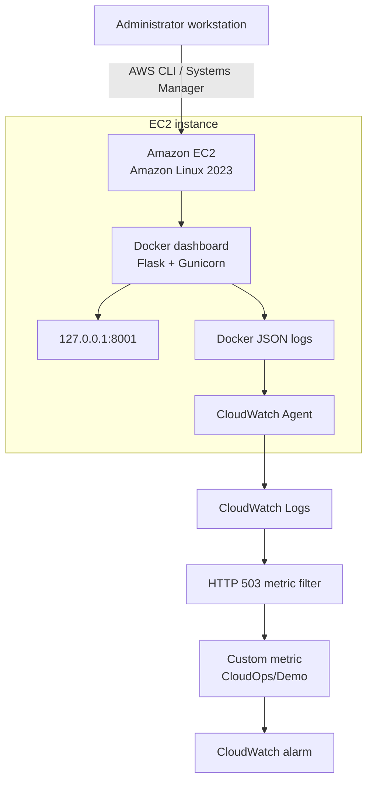

# AWS Cloud Operations Lab

A hands-on AWS operations portfolio project demonstrating infrastructure as code, secure remote administration, containerised application hosting, CloudWatch monitoring and alerting, patch-compliance assessment, and incident recovery.

## Project overview

This project runs a Flask operations dashboard in Docker on Amazon EC2. AWS Systems Manager provides remote administration, while the CloudWatch Agent forwards container logs to CloudWatch Logs. A metric filter detects simulated Payment API HTTP 503 failures and drives a CloudWatch alarm.

The goal is to demonstrate practical cloud operations and troubleshooting without building an unnecessarily expensive infrastructure stack.

## Architecture



**AWS region:** `ap-southeast-1` (Singapore)

See [`docs/architecture.md`](docs/architecture.md) for the deployed architecture and design boundaries.

## What this project demonstrates

- **Infrastructure as code:** AWS CDK and CloudFormation.
- **Compute and containers:** A Flask dashboard served by Gunicorn inside Docker on an Amazon Linux 2023 EC2 instance.
- **Remote administration:** AWS Systems Manager for operational commands and health checks.
- **Centralised logging:** CloudWatch Agent forwarding Docker logs to CloudWatch Logs, with 14-day retention.
- **Monitoring and alerting:** A CloudWatch Logs metric filter detects simulated HTTP 503 failures and publishes a custom metric used by a CloudWatch alarm.
- **Incident simulation and recovery:** Trigger a controlled application failure, observe the alarm, restore service, and verify recovery.
- **Patch compliance:** A Systems Manager Patch Manager scan reported zero missing, failed, security non-compliant, and critical non-compliant patches under the applied baseline on 28 October 2026.
- **Operational documentation:** Runbook covering health checks, troubleshooting, monitoring, recovery, patch assessment, and cost precautions.

## Failure-monitoring demonstration

The dashboard includes endpoints for a safe, simulated service failure:

| Method | Endpoint | Purpose |
|---|---|---|
| `GET` | `/health` | Check dashboard health |
| `GET` | `/demo/payment-health` | Check simulated Payment API health |
| `POST` | `/demo/simulate-failure` | Activate the simulated failure |
| `POST` | `/demo/restore` | Restore simulated service health |

The verified test sequence produced an HTTP 503 response, a matching CloudWatch Logs event, a custom metric datapoint of `1.0`, and an `ALARM` state. After restoration, the endpoint returned HTTP 200 and the alarm later returned to `OK`.

This is a demonstration only; it does not connect to or affect a real payment service. The alarm currently has no notification actions configured.

## Container build

The dashboard uses a dedicated runtime dependency file so the deployed image does not need the AWS CDK development dependencies.

The latest runtime image was **131 MB**, down from the previous **522 MB** image. The replacement container passed checks for `/health`, `/demo/payment-health`, and the dashboard page, all returning HTTP 200.

## Testing

Run the local test suite:

```bash
source .venv/bin/activate
pytest -q
```

Latest confirmed local result: **18 passed**.

Check the repository before committing changes:

```bash
git status --short
git diff --check
```

## Documentation

- [`docs/architecture.md`](docs/architecture.md) — deployed monitoring architecture, network design, security and cost considerations.
- [`docs/runbook.md`](docs/runbook.md) — operational procedures, troubleshooting, monitoring and recovery.
- [`docs/v2_runbook.md`](docs/v2_runbook.md) — supplementary operational notes.

## Cost and security considerations

- The dashboard host port is bound to `127.0.0.1:8001` on the EC2 instance, rather than directly exposed through that binding to the public internet.
- Systems Manager is used for remote administration instead of opening SSH as a shortcut.
- The current deployment does not include a NAT Gateway or Application Load Balancer.
- CloudWatch Logs retention is set to 14 days.
- The CloudWatch failure alarm changes state but does not send notifications.
- AWS charges may still apply for EC2, storage, public IPv4, logging, and other resources. Review costs before making changes.

The project is designed to preserve unrelated AWS resources. Review CDK synthesis and infrastructure diffs before deployment; do not deploy or destroy resources without checking the impact.

## Repository

[GitHub: aws-cloud-operations-lab](https://github.com/aimanhaizal/aws-cloud-operations-lab)
