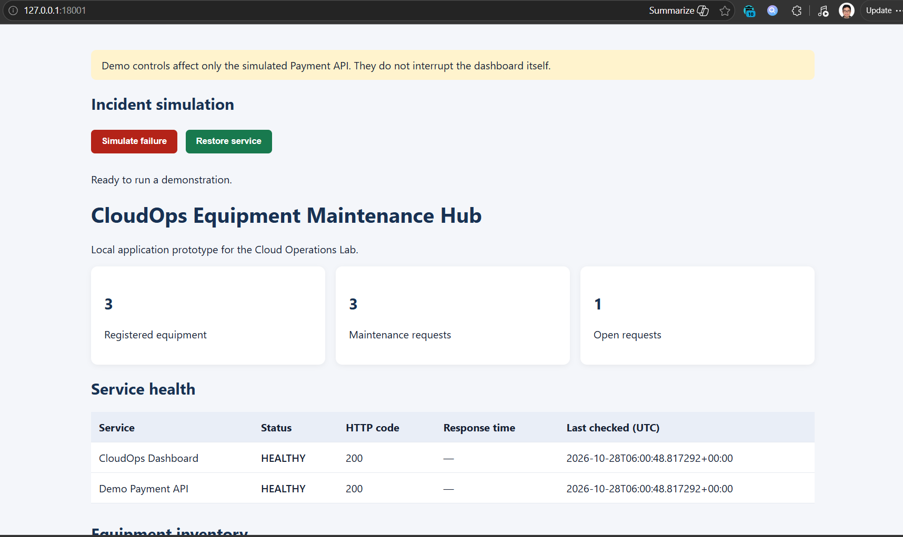
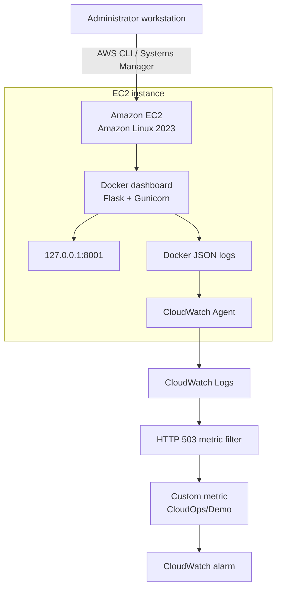

# AWS Cloud Operations Lab

A hands-on AWS portfolio project focused on **cloud operations, infrastructure as code, monitoring, Linux administration, and incident troubleshooting**.

This project runs a containerised Flask dashboard on Amazon EC2 and uses AWS Systems Manager and Amazon CloudWatch to demonstrate secure remote administration, centralised logging, alerting, patch-compliance assessment, and recovery testing.

## Key skills demonstrated

- **AWS compute and Linux:** Amazon EC2, Amazon Linux 2023, Docker and Gunicorn.
- **Infrastructure as code:** AWS CDK and AWS CloudFormation.
- **Remote administration:** AWS Systems Manager Run Command and health checks.
- **Monitoring and alerting:** CloudWatch Agent, CloudWatch Logs, metric filters, custom metrics and alarms.
- **Incident response:** Simulated HTTP 503 failures, alarm-state verification and application recovery.
- **Patch compliance:** Systems Manager Patch Manager scan and compliance review.
- **Container optimisation:** Reduced the dashboard runtime image from 522 MB to 131 MB.
- **Testing and documentation:** 18 passing local tests, an operations runbook and architecture documentation.

## Dashboard



## Architecture



The dashboard host port is bound to `127.0.0.1:8001`, rather than being directly exposed through that binding to the public internet. Remote administrative operations use Systems Manager.

## Monitoring and incident recovery

The project demonstrates an end-to-end monitoring workflow:

1. Activate a controlled Payment API failure simulation.
2. Generate an HTTP 503 response from the demo health endpoint.
3. Collect the container access log in CloudWatch Logs.
4. Match the failure using a CloudWatch Logs metric filter.
5. Publish a custom metric and trigger a CloudWatch alarm.
6. Restore the simulated service and verify HTTP 200 and alarm recovery.

**Verified result:** The failure simulation produced a metric datapoint of `1.0`, the alarm entered `ALARM`, and the alarm subsequently returned to `OK` after recovery.

This is a simulated service failure, not a real payment system. The alarm currently has no email or other notification actions configured.

## Operations and compliance

- EC2 CPU utilisation and status-check alarms are configured.
- The CloudWatch Agent forwards Docker logs to CloudWatch Logs.
- The log group has 14-day retention.
- A Systems Manager Patch Manager scan completed on 28 October 2026 with zero missing, failed, security non-compliant, and critical non-compliant patches under the applied baseline.
- The patch assessment was scan-only; it did not install updates or reboot the instance.

## Testing

The latest confirmed local test run reported **18 passing tests**.

Run the test suite locally:

```bash
source .venv/bin/activate
pytest -q
```

## Technology stack

| Area | Technologies |
|---|---|
| Cloud platform | AWS |
| Compute and OS | EC2, Amazon Linux 2023 |
| Containers | Docker |
| Application | Python, Flask, Gunicorn |
| Infrastructure as code | AWS CDK, CloudFormation |
| Operations | Systems Manager, Patch Manager |
| Observability | CloudWatch Agent, CloudWatch Logs, metrics and alarms |
| Testing | pytest |
| Version control | Git, GitHub |

## Current scope and limitations

This project focuses on a cost-conscious EC2 operations lab. It does not currently demonstrate a deployed Application Load Balancer, Auto Scaling group, ECS/EKS workload, managed database, automated backup-and-restore process, Windows Server administration, Security Hub/Inspector remediation, or a CI/CD pipeline.

These are potential future extensions, not capabilities claimed by the current deployment.

## Documentation

- [Architecture](docs/architecture.md)
- [Operations runbook](docs/runbook.md)
- [Supplementary runbook](docs/v2_runbook.md)

## Cost and security

The lab avoids adding infrastructure without first reviewing its operational value and cost. AWS charges may still apply to compute, storage, public IPv4 addresses, logging, and other resources.

Review CDK synthesis and infrastructure diffs before deployment. Preserve unrelated AWS stacks and resources.

## Repository

[View the project on GitHub](https://github.com/aimanhaizal/aws-cloud-operations-lab)
